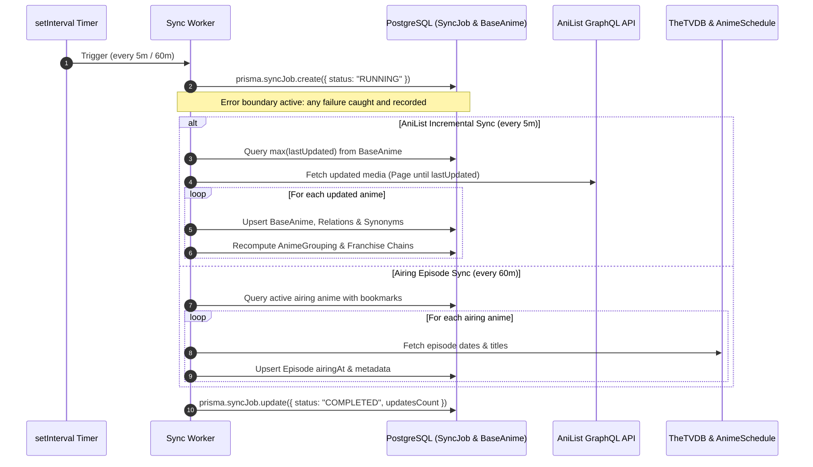

# Anily

Anily is a work-in-progress selfhosted anime streaming service.

Note a lot of this project is still very work-in-progress. While most of the architecture was human made, a lot of the details are semi-reviewed AI code. No guarantee of any kind of functionality, safety, or security is given.

Compared to most other options available, it however has these benefits:
- Propper anime grouping. Anime does not always follow the western-style season formats. Especially when it comes to databases for metadata, this can get really messy. Anily has a custom logic that aranges all related anime into an "anime grouping". You can think of these as franchises that you bookmark. Instead of trying to squish a squere into a circular hole, this allows a logical sorting without ignoring or jumbling different releases.
- Low storage usage as Anily streams from freely available servers and does not need to download everything.
- Material Design compliant-ish UI, which works well on pc, phone, and foldable.
- Android application allowing offline functionality through on-device downloads.
- Selfhostable with OIDC-Authentication.
- Japanese subtitle integration via Jimaku.cc with dynamic Furigana generation, automatically enabled in Native preset.

## Scheduled Background Jobs

Anily runs autonomous background sync workers to ensure anime catalogs, franchise groupings, and airing episode schedules remain up to date without manual supervision:

### 1. `keepAnilistDataUpdated` (every 5 minutes)
- Fetches newly modified anime from AniList GraphQL since the most recent `lastUpdated` timestamp in the database.
- Upserts titles, native/romaji variants, synonyms, and franchise relation graphs (`prequel`, `sequel`, `side_story`, `spin_off`).
- Automatically triggers `updateAnimeGroupingIfNeeded` to rebuild connected franchise chains for bookmarked titles.

### 2. `syncAiringEpisodes` (every 60 minutes)
- Queries bookmarked ongoing series and synchronizes future episode air dates from TheTVDB v4 and AnimeSchedule.
- Ensures the "Inbox" and "Caught Up" sidebar tabs accurately track next-episode releases.
